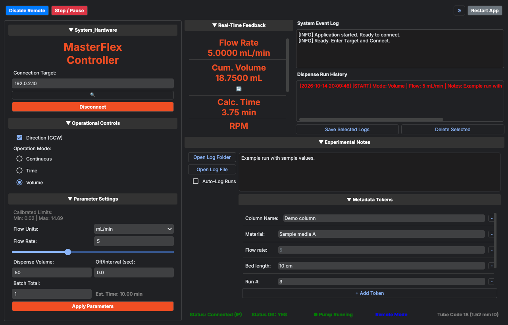

# Masterflex REGLO Pump Control

[](https://github.com/brandonbtm29/Masterflex-REGLO-Pump-Ethernet-Control/actions/workflows/ci.yml)
[](https://github.com/brandonbtm29/Masterflex-REGLO-Pump-Ethernet-Control/releases/latest)
[](LICENSE)

**Run a Masterflex REGLO peristaltic pump from your computer over Ethernet.**

A desktop app (Windows, macOS, Linux) that connects to a Masterflex REGLO Digital pump drive
with Advanced Connectivity over EtherNet/IP. Set the flow rate, run continuously or dispense a
set volume, watch flow and volume live, and keep a log of every run with your own notes.



## Why

The REGLO's touchscreen is fine for one-off runs, but a lab experiment needs repeatable
settings, a record of what ran when, and the pump controlled from the same computer as the
rest of the setup. The pump speaks EtherNet/IP, an industrial protocol, and it has a few quirks
that stop normal EtherNet/IP tools from working with it. This app handles those quirks.

It was written for flow-through column experiments in a polymer engineering lab, but works for
any REGLO with Advanced Connectivity (models 78018-10, 78018-12, 78018-40 and similar).

## Features

- **Connect by IP or search the network**: type the pump's address, or let the app find it.
- **Live dashboard**: flow rate, cumulative volume, run time (and time left in a dispense),
  estimated RPM, batch progress, run state, remote/local mode, head-open warning and tube size,
  updated 10 times a second. Drag the tiles into the order you like.
- **Continuous, Time and Volume modes**: Time and Volume modes dispense for a set time or
  volume, pause for an interval, and repeat a set number of times (or until you stop them).
  Volume mode shows an estimated run time before you start.
- **Flow units**: all 16 units the drive supports (mL/min, µL/hr, L/day, RPM, % and more). The
  slider and Apply are limited to the pump's calibrated minimum and maximum, and impossible
  values (0 or negative) are refused with a message.
- **Direction, remote mode, and reset** of cumulative volume and batch count from the app.
- **Run log**: every start and finish (time, mode, flow, volume dispensed, duration) goes into
  a run history. With Auto-Log on, runs are also written to a CSV file; otherwise you pick which
  runs to save. Columns stay lined up when you add or remove metadata fields.
- **Safe stops**: Disconnect or closing the app stops a running pump first and logs the end of
  the run. A program that sees the pump stopped from its touchscreen gives up instead of
  restarting it later.
- **Experiment notes and metadata tokens**: free-text notes plus named fields (column, material,
  bed length, run number, or anything you add) that are written into each log row.
- **Remembers your settings** between sessions, and can keep them in a synced folder so several
  computers share them.
- **Firmware helper**: copies a firmware file you downloaded onto a USB drive and shows the
  update steps for the pump.
- **One-click updates** from GitHub releases, and a **desktop icon** with the pump logo
  (a Mac app, a Windows shortcut, or a Linux menu entry), both in ⚙ → App.
- **Double-click launchers** for Windows and macOS.

## Quick start

You need Python 3.11 or newer and the pump on the same network as your computer.

```bash
git clone https://github.com/brandonbtm29/Masterflex-REGLO-Pump-Ethernet-Control.git
cd Masterflex-REGLO-Pump-Ethernet-Control
python -m venv .venv
```

Then install and run. On **Windows**:

```bat
.venv\Scripts\python -m pip install -r requirements.txt
Launch_Windows.bat
```

On **macOS / Linux**:

```bash
.venv/bin/python -m pip install -r requirements.txt
./Launch_Mac.command        # or: .venv/bin/python pump_gui.py
```

After this, double-click `Launch_Windows.bat` or `Launch_Mac.command` to start the app, or
open ⚙ → **App** and click **Add App Icon to Desktop** (macOS) / **Add Shortcut to Desktop**
(Windows) to get an icon you can double-click or keep in the Dock or taskbar.

In the app: enter the pump's IP address (or click the search button), click **Connect**, then
**Enable Remote**. Set the flow rate and mode, click **Apply Parameters**, then **Start / Run**.

## Using it

| Control | What it does |
|---|---|
| Search (🔍) | Looks for EtherNet/IP devices on the local network and fills in the pump's address |
| Connect / Disconnect | Opens or closes the EtherNet/IP connection |
| Enable / Disable Remote | Switches the pump between touchscreen (local) and computer (remote) control |
| Start / Run, Stop / Pause | Starts or pauses the pump (or a Time/Volume program, including its pauses). Start also applies the current parameters |
| Direction (CCW) | Counter-clockwise when ticked. Changing it stops the pump first |
| Operation Mode | Continuous runs until stopped. Time runs for On Time seconds, Volume until the Dispense Volume is pumped; both then pause for Off/Interval seconds and repeat Batch Total times (0 = until stopped) |
| Apply Parameters | Sends flow rate, volume, times and batch count to the pump |
| 🔄 under the tiles | Resets cumulative volume or batch count |
| Save Selected / Delete Selected | Writes chosen runs from the history to the CSV log, or removes them from the history and `run_log_backup.csv` (after asking; the previous file is kept as `.bak`) |
| Open Log Folder / Open Log File | Opens the data folder or the CSV log |
| ⚙ → Hardware | Maximum drive RPM (for the RPM estimate), icon buttons, the settings folder |
| ⚙ → App | Version, **Check for Updates**, and the desktop icon button |
| ⚙ → Firmware | Copies a firmware file onto a USB drive and shows the pump's update steps |

## Where files go

The app keeps your **data** apart from the code:

- **Data folder**: `~/SyncThing/UAkron Playground/MasterFlex Pump` by default (it's created if
  missing). Run logs go in its `Data/` folder: `run_log.csv` (runs you chose to save) and
  `run_log_backup.csv` (every run). To use a different folder, set the environment variable
  `UAKRON_APP_DATA_DIR` to the folder, or `UAKRON_DATA_DIR` to a parent folder (the app then
  uses `MasterFlex Pump` inside it).
- **Settings**: `pump_config.json`, next to the app by default. It's saved in one step, so a
  crash can't leave half a file; if it ever can't be read, the app keeps a copy
  (`pump_config.json.unreadable-<time>`), starts from defaults and says so in the event log. In ⚙ → **Settings Folder** you
  can move it, for example into a synced folder so several computers share the same settings.
  That choice is stored per computer in `settings_location.json`. The environment variable
  `UAKRON_SETTINGS_DIR` overrides it.

Neither settings nor logs are committed to git.

## Configuration

The app writes `pump_config.json` itself; you don't need to edit it.
[`pump_config.example.json`](pump_config.example.json) shows every key:

| Key | Meaning |
|---|---|
| `ip` | Last pump address |
| `max_rpm` | Maximum drive RPM, used to estimate RPM from flow (default 160) |
| `mode` | 0 = Continuous, 1 = Time, 2 = Volume |
| `direction` | `CW` or `CCW` |
| `unit` | Flow unit, e.g. `mL/min` |
| `flow`, `vol`, `on_time`, `off_time`, `batch` | Last parameter values |
| `notes` | Experiment notes box |
| `use_icons` | Icon buttons instead of text |
| `monitor_order` | Order of the dashboard tiles |
| `metadata_tokens` | Metadata fields and their values, in order |

## How it works

`pump_gui.py` is a PyQt6 app. It uses [`pycomm3`](https://github.com/ottowayi/pycomm3) to
send EtherNet/IP explicit messages. A background thread reads the pump's status, runs any
Time/Volume program, and re-sends its control block every 100 ms; the window refreshes from
the latest status on its own 100 ms timer, so a busy window can't delay a stop.

| File | What's in it |
|---|---|
| `pump_gui.py` | The window, connection handling and the comms thread |
| `protocol.py` | The byte maps below: decoding status, packing commands, unit helpers |
| `dispense.py` | Time/Volume programs (dispense, pause, repeat) |
| `runlog.py` | Run log CSV files that keep their columns aligned |
| `updates.py` | Checking GitHub releases and updating a git clone |
| `shortcuts.py` | The desktop icon for macOS, Windows and Linux |
| `settings_location.py` | Where settings live (shared with other lab apps) |

Three things about the REGLO make this different from talking to a PLC:

1. **No normal handshake.** The pump drops the connection if a client asks for its identity
   object or tag list, which `pycomm3`'s `LogixDriver` does when it connects. The app uses a
   small subclass, `PumpDriver`, that skips that step (`_initialize_driver` does nothing).
2. **100 ms watchdog.** In remote mode the pump stops its motor if it doesn't get a control
   packet every few hundred milliseconds. The background thread sends the full 28-byte output
   block every 100 ms while connected.
3. **No tags, only assemblies.** You can't write to a named tag like `Output.Run`. The app
   reads and writes raw CIP assembly objects (class `0x04`, attribute `0x03`):
   instance **100** is the 56-byte input (read), instance **112** the 28-byte output (write).

### Input assembly (instance 100, 56 bytes, read)

| Byte offset | Type | Meaning |
|---|---|---|
| 0–3 | INT32 | Status. Bit 0: status OK, bit 1: pump running, bit 2: dispense running, bit 4: head open, bit 7: remote mode active |
| 4 | BYTE | Dispense mode (0 = continuous, 1 = time, 2 = volume) |
| 5 | BYTE | Tube size code (the Masterflex manual's Table 4 is missing; the app's table is `TUBE_CODES_MM` in `protocol.py`) |
| 6 | BYTE | Flow unit code (Table 3, below) |
| 8–11 | FLOAT | Cumulative volume |
| 24–27 | INT32 | Current batch count |
| 32–35 | FLOAT | Minimum flow rate |
| 36–39 | FLOAT | Current flow rate |
| 40–43 | FLOAT | Maximum flow rate |

### Output assembly (instance 112, 28 bytes, write)

| Byte offset | Type | Meaning |
|---|---|---|
| 0 | BYTE | Control. Bit 0: run (1) / pause (0). Bit 1: stop/reset dispense, bit 2: toggle remote mode, bit 3: clear cumulative volume (these three act on a 1-to-0 transition). Bit 6: direction (1 = CCW, 0 = CW) |
| 4 | BYTE | Dispense mode (0 = continuous, 1 = time, 2 = volume) |
| 6 | BYTE | Flow unit code (0–15, Table 3) |
| 8–11 | FLOAT | Flow rate |
| 12–15 | FLOAT | Dispense volume |
| 16–19 | FLOAT | Dispense on / run time (s) |
| 20–23 | FLOAT | Dispense off / pause time (s) |
| 24–27 | INT32 | Batch total (0 = repeat forever) |

### Flow unit codes (Table 3)

`0: L/S, 1: mL/min, 2: mL/hr, 3: L/min, 4: L/hr, 5: L/day, 6: uL/min, 7: uL/hr, 8: gal/min,
9: gal/hr, 10: gal/day, 11: oz/min, 12: oz/hr, 13: cum/hr, 14: RPM, 15: %`

## Limitations

- **Time and Volume modes are run by the app, not the pump.** The drive didn't reliably accept
  dispense settings over EtherNet/IP, so the app keeps the drive in continuous mode and starts
  and pauses it itself ([`dispense.py`](dispense.py)). It checks every 100 ms, so each dispense
  can run up to about 0.1 s longer than set, and the app must stay open and connected for the
  program to stop. In remote mode the pump also stops on its own if the app goes quiet.
- **If the pump stops answering**, the status bar shows "No response from pump", the event log
  says why, and the app keeps retrying. It logs again when the pump is back.
- **RPM is an estimate.** The pump doesn't report its speed; the app scales the flow by the
  pump's maximum flow for the fitted tube, reached at the Max Drive RPM set in ⚙ → Hardware.
- **Updates come from GitHub releases** and only work for a git clone with no hand-edited
  files. A built app (`.exe`/`.app`) links to the releases page instead.
- **USB is for firmware only.** The REGLO's USB port can't control the pump, and the older
  `masterflex-serial` library for L/S and I/P pumps doesn't work with this series.
- **No security on the pump.** Anyone on the same network can control it. Keep it on a lab
  network you trust (see [SECURITY.md](SECURITY.md)).
- The default data folder assumes a SyncThing layout; set `UAKRON_APP_DATA_DIR` if you don't
  use one.

## Development

```bash
python -m venv .venv
.venv/bin/python -m pip install -e ".[dev]"     # Windows: .venv\Scripts\python ...
pytest                                          # headless, no pump needed
ruff check . && ruff format --check .
python scripts/make_screenshot.py               # regenerate docs/screenshot.png
```

Build a standalone app (`.exe` on Windows, `.app` on macOS, a folder on Linux) into `dist/`:

```bash
pip install -e ".[build]"
python build_app.py
```

**Releasing:** the app's **Check for Updates** offers the newest GitHub *release*, so publish
one for every version people should get. Bump `__version__` in `pump_gui.py` (the only place it lives), move the
"Unreleased" notes in [CHANGELOG.md](CHANGELOG.md) under the new version and date, run the
checks above, then commit, tag (`git tag -a vX.Y.Z -m "Masterflex REGLO Pump Control X.Y.Z"`),
push the commit and the tag, and create the GitHub release from that changelog section with
`gh release create vX.Y.Z --verify-tag`.

## How this was built

Masterflex REGLO Pump Control is written and maintained by Brandon T. McReynolds with the help
of AI coding assistants. Versions before October 2026 were co-developed with Google Gemini in
Antigravity. Later versions were co-developed with Claude (Anthropic); those commits list Claude
as a co-author. Brandon directs the work, reviews and tests the changes, and is responsible for
the project.

## License

[MIT](LICENSE) © 2026 Brandon T. McReynolds. Not affiliated with or endorsed by Masterflex.
